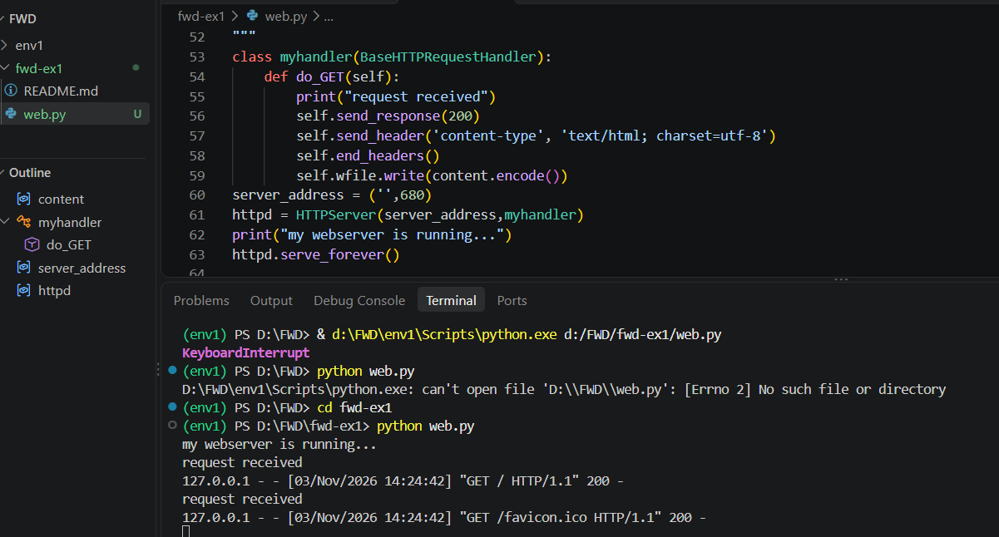
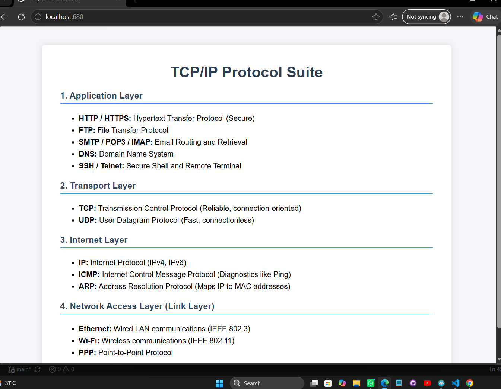

# EX01 Developing a Simple Webserver
## Date:11-11-2026
## REG NO:26018936
## AIM:
To develop a simple webserver to serve html pages and display the list of protocols in TCP/IP Protocol Suite.

## DESIGN STEPS:
### Step 1: 
HTML content creation.

### Step 2:
Design of webserver workflow.

### Step 3:
Implementation using Python code.

### Step 4:
Import the necessary modules.

### Step 5:
Define a custom request handler.

### Step 6:
Start an HTTP server on a specific port.

### Step 7:
Run the Python script to serve web pages.

### Step 8:
Serve the HTML pages.

### Step 9:
Start the server script and check for errors.

### Step 10:
Open a browser and navigate to http://127.0.0.1:8000 (or the assigned port).

## PROGRAM:
~~~
from http.server import HTTPServer, BaseHTTPRequestHandler
content = """
<!DOCTYPE html>
<html lang="en">
<head>
    <meta charset="UTF-8">
    <meta name="viewport" content="width=device-width, initial-scale=1.0">
    <title>TCP/IP Protocol Suite</title>
    
</head>
<body>
    

        <h1>TCP/IP Protocol Suite</h1>
        
        <h3>1. Application Layer</h3>
        <ul>
            <li><strong>HTTP / HTTPS:</strong> Hypertext Transfer Protocol (Secure)</li>
            <li><strong>FTP:</strong> File Transfer Protocol</li>
            <li><strong>SMTP / POP3 / IMAP:</strong> Email Routing and Retrieval</li>
            <li><strong>DNS:</strong> Domain Name System</li>
            <li><strong>SSH / Telnet:</strong> Secure Shell and Remote Terminal</li>
        </ul>

        <h3>2. Transport Layer</h3>
        <ul>
            <li><strong>TCP:</strong> Transmission Control Protocol (Reliable, connection-oriented)</li>
            <li><strong>UDP:</strong> User Datagram Protocol (Fast, connectionless)</li>
        </ul>

        <h3>3. Internet Layer</h3>
        <ul>
            <li><strong>IP:</strong> Internet Protocol (IPv4, IPv6)</li>
            <li><strong>ICMP:</strong> Internet Control Message Protocol (Diagnostics like Ping)</li>
            <li><strong>ARP:</strong> Address Resolution Protocol (Maps IP to MAC addresses)</li>
        </ul>

        <h3>4. Network Access Layer (Link Layer)</h3>
        <ul>
            <li><strong>Ethernet:</strong> Wired LAN communications (IEEE 802.3)</li>
            
            <li><strong>Wi-Fi:</strong> Wireless communications (IEEE 802.11)</li>
            <li><strong>PPP:</strong> Point-to-Point Protocol</li>
        </ul>
    

</body>
</html>
"""
class myhandler(BaseHTTPRequestHandler):
    def do_GET(self):
        print("request received")
        self.send_response(200)
        self.send_header('content-type', 'text/html; charset=utf-8')
        self.end_headers()
        self.wfile.write(content.encode())
server_address = ('',680)
httpd = HTTPServer(server_address,myhandler)
print("my webserver is running...")
httpd.serve_forever() 

~~~

## OUTPUT:

## RESULT:
The program for implementing simple webserver is executed successfully.

